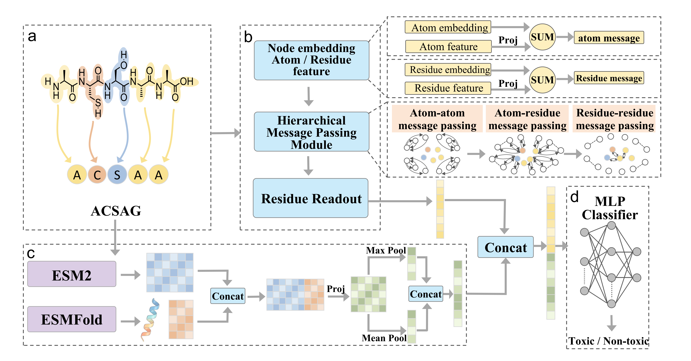

# HiPepTox

**基于残基—原子异构图与多模态表征的多肽毒性预测框架。**

HiPepTox 将多肽的原子信息、残基信息、蛋白质语言模型表征和残基级结构描述符相结合，通过分层图消息传递和后期融合完成毒性分类。本项目提供模型实现、训练入口、实验配置、基准数据及基线代码。

## 模型框架



HiPepTox 的计算流程包括四个部分：

1. **残基—原子异构图构建**：将残基与重原子作为不同类型的节点，编码原子连接、原子与残基的对应关系及残基之间的关系。
2. **分层消息传递**：在原子与残基两个层次聚合信息，得到多肽的图表征。
3. **语言模型与结构表征**：使用 ESM2-t30-150M 的第 28、29、30 层残基表征均值，结合每个残基的 45 维结构描述符，形成辅助表征。
4. **后期融合与分类**：融合图分支和辅助分支的输出，通过分类器预测多肽的毒性类别。

模型代码位于 [model/hipeptox.py](model/hipeptox.py)。配置中的模型类名为 `HiPepTox`。

## 目录结构

```text
.
├── README.md
├── LICENSE
├── requirements.txt
├── pyproject.toml
├── MANIFEST.in
├── figures/
│   └── HiPepTox_framework.png
├── model/
│   ├── hipeptox.py
│   └── baseline/
│       ├── captp/
│       ├── peptitox/
│       ├── plptp/
│       ├── structoxnet/
│       ├── tamper/
│       ├── toxgin/
│       ├── toxinpred3/
│       ├── toxipep/
│       ├── toxmsrc/
│       ├── toxteller/
│       └── registry.json
├── configs/
│   ├── reproduction/
│   │   ├── cdhit08.yaml
│   │   └── cdhit09.yaml
│   ├── single_task/
│   └── examples/
├── scripts/
├── util/
│   ├── data/
│   ├── datasets/
│   └── tasks/
└── data/
    ├── raw/
    └── processed/
```

| 路径 | 内容 |
| --- | --- |
| `model/` | HiPepTox 模型与基线实现 |
| `configs/reproduction/` | CD-HIT 0.8 和 0.9 主模型配置 |
| `configs/single_task/` | 主模型及消融配置 |
| `scripts/` | 模型训练及特征处理入口 |
| `util/` | 图构建、数据集、训练任务及指标工具 |
| `data/raw/` | 原始序列与标签数据 |
| `data/processed/` | 整理后的 CSV、固定数据划分及结构样本映射 |
| `figures/` | 模型框架图 |

## 环境与安装

项目声明的主要依赖如下，完整列表见 [requirements.txt](requirements.txt) 和 [pyproject.toml](pyproject.toml)。

| 依赖 | 项目声明 |
| --- | --- |
| Python | ≥ 3.10 |
| PyTorch | ≥ 1.12 |
| TorchDrug | 0.2.1 |
| NumPy | ≥ 1.21 且 < 2 |
| 其他 | pandas、SciPy、scikit-learn、PyYAML、Jinja2、tqdm、easydict、ninja |

以下命令均在项目根目录执行：

```bash
python -m pip install -r requirements.txt
python -m pip install --no-deps --no-build-isolation -e .
export PYTHONPATH="$PWD"
```

PyTorch、CUDA 与 TorchDrug 的扩展依赖应使用匹配的运行环境。各基线的额外依赖以其目录中的 `requirements.txt`、`environment.yml` 和 [registry.json](model/baseline/registry.json) 为准。

## 数据集

主模型使用 CD-HIT 0.8 和 0.9 两套基准数据。内部集的训练与验证划分已写入 CSV 的 `split` 列；外部测试集单独存放。

| 基准数据 | 训练样本 | 验证样本 | 测试样本 | 总计 |
| --- | ---: | ---: | ---: | ---: |
| CD-HIT 0.8 | 4,712 | 832 | 1,388 | 6,932 |
| CD-HIT 0.9 | 5,998 | 1,058 | 1,766 | 8,822 |

对应目录：

```text
data/processed/
├── toxipep08_internal_85_15/
├── toxipep08_external_test/
├── toxipep09_internal_85_15/
└── toxipep09_external_test/
```

各目录的主数据文件为 `peptide_toxicity.csv`，主要字段如下：

| 字段 | 含义 |
| --- | --- |
| `id` | 样本标识 |
| `sequence` | 多肽氨基酸序列 |
| `toxicity` | 二分类标签：`1` 为毒性，`0` 为非毒性 |
| `split` | `train`、`validation` 或 `test` |
| `source` | 数据来源 |
| `orig_record_id`、`header` | 原始记录的追溯信息 |

结构映射文件 `peptide_toxicity_structoxnet_mapping.csv` 记录样本与结构标识之间的对应关系。实验应沿用 CSV 中已有的划分。

## 主模型训练

两套数据的训练配置分别位于：

- [configs/reproduction/cdhit08.yaml](configs/reproduction/cdhit08.yaml)
- [configs/reproduction/cdhit09.yaml](configs/reproduction/cdhit09.yaml)

### 训练命令

```bash
# CD-HIT 0.9
bash scripts/train_seeds.sh cdhit09 '[0]'

# CD-HIT 0.8
bash scripts/train_seeds.sh cdhit08 '[0]'

# 依次运行两套数据
bash scripts/train_seeds.sh all '[0]'
```

`'[0]'` 表示使用 GPU 0；CPU 模式使用 `null`。第三个参数可指定输出根目录，默认值为 `outputs/reproduction`。

```bash
bash scripts/train_seeds.sh cdhit09 null outputs/reproduction_cpu
```

### 默认训练设置

| 参数 | 当前主模型配置 |
| --- | --- |
| 训练轮数 | 50 |
| Batch size | 128 |
| 优化器 | Adam |
| 学习率 | 0.0005 |
| Weight decay | 0.001 |
| 学习率调度 | CosineAnnealingLR，`T_max=50` |
| 选模指标 | 验证集 Macro F1 |

网络和分类头的具体设置以各 YAML 配置为准。每轮训练后评估验证集，并保存验证集指标最优的模型。

### 训练输出

每次训练生成独立的运行目录，保存以下文件：

| 文件 | 内容 |
| --- | --- |
| `resolved_config.yaml` | 本次运行的完整配置 |
| `run_metadata.json` | 运行信息 |
| `validation_history.csv` | 每轮验证集指标 |
| `best_checkpoint.json` | 验证集选模记录 |
| `best_valid_epoch_<N>.pth` | 验证集指标最优的模型 |
| `model_epoch_<N>.pth` | 各轮训练模型 |

## 基线模型

基线代码位于 [model/baseline/](model/baseline/)。

| 方法 | 目录 | 主要入口 |
| --- | --- | --- |
| ToxiPep | `toxipep/` | [Code/train_eval_csv.py](model/baseline/toxipep/Code/train_eval_csv.py) |
| ToxTeller（LR / RF / SVM / XGBoost） | `toxteller/` | [program_resource/train_eval_csv.py](model/baseline/toxteller/program_resource/train_eval_csv.py) |
| ToxMSRC | `toxmsrc/` | [scripts/train_eval_csv_torch.py](model/baseline/toxmsrc/scripts/train_eval_csv_torch.py) |
| PLPTP | `plptp/` | [scripts/train_eval_csv.py](model/baseline/plptp/scripts/train_eval_csv.py) |
| CAPTP | `captp/` | [scripts/train_eval_csv.py](model/baseline/captp/scripts/train_eval_csv.py) |
| tAMPer | `tamper/` | [scripts/train_tamper_csv.py](model/baseline/tamper/scripts/train_tamper_csv.py) |
| ToxGIN | `toxgin/` | [scripts/train_toxgin_csv.py](model/baseline/toxgin/scripts/train_toxgin_csv.py) |
| PeptiTox | `peptitox/` | [train_cached_external.py](model/baseline/peptitox/train_cached_external.py) |
| StrucToxNet | `structoxnet/` | [scripts/train_csv.py](model/baseline/structoxnet/scripts/train_csv.py)；[scripts/evaluate_csv.py](model/baseline/structoxnet/scripts/evaluate_csv.py) |
| ToxinPred3 | `toxinpred3/` | [scripts/evaluate_csv.py](model/baseline/toxinpred3/scripts/evaluate_csv.py)；作者发布实现 |

各方法使用自己的模型实现和参数接口。入口索引见 [registry.json](model/baseline/registry.json)，运行所需资源见 [基线资源准备](model/baseline/PREPARATION.md)。

## 主要脚本

| 脚本 | 用途 |
| --- | --- |
| `scripts/train.py` | 按 YAML 配置训练单个模型 |
| `scripts/train_seeds.sh` | 主模型多种子训练 |
| `scripts/extract_plm.py` | 蛋白质语言模型表征提取 |
| `scripts/structure_features.py` | 45 维残基级结构描述符计算 |
| `scripts/prepare_structure_inputs.py` | DSSP 表与残基接触记录处理 |
| `scripts/build_contacts.py` | 基于 PDB 的残基接触边计算 |
| `scripts/csv_to_fasta.py` | CSV 序列导出为 FASTA |
| `scripts/ensemble.py` | 模型集成 |

## 许可

HiPepTox 项目代码使用 [MIT License](LICENSE)。整合的第三方基线代码适用各自目录中的许可条款。
